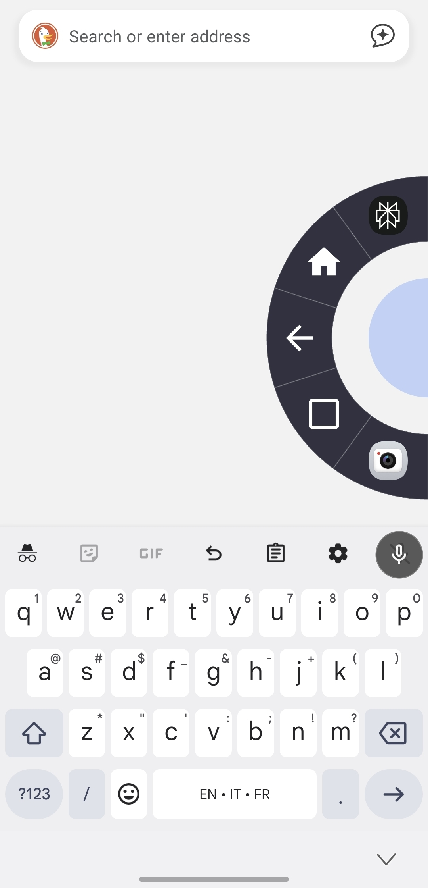
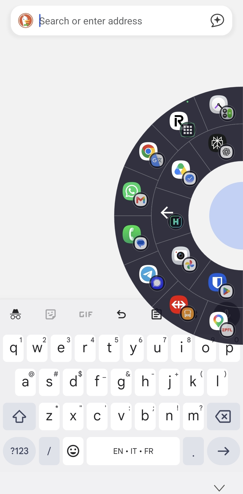
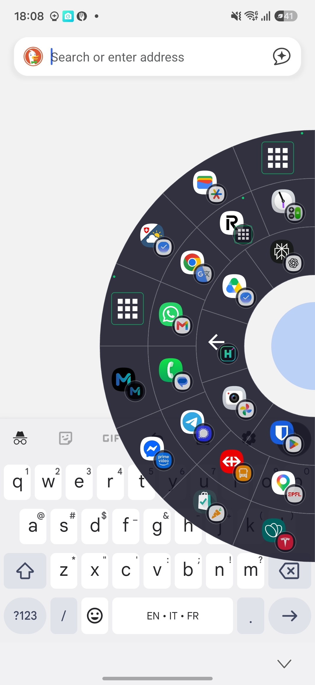
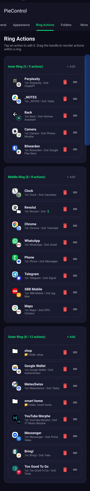
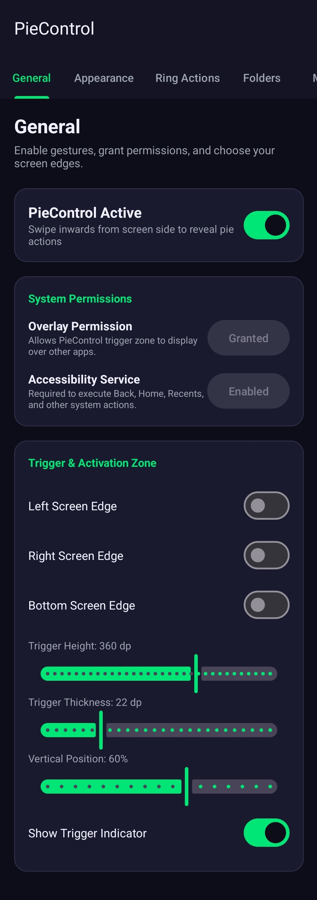
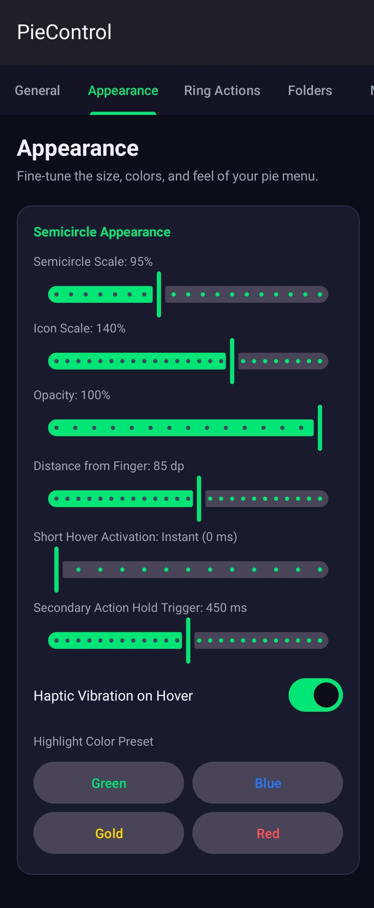
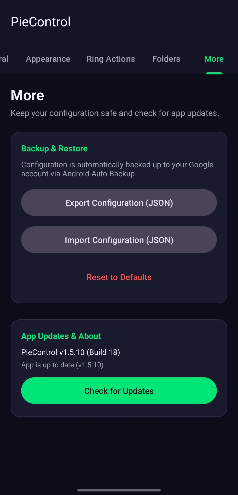

# PieControl for Android

A modern, fluid Android navigation gesture app. Swipe inward from any screen edge to reveal a customizable semicircle ring of actions organized across up to three concentric layers.

## Screenshots

<table>
  <tr>
    <td align="center"><br><sub>One action ring</sub></td>
    <td align="center"><br><sub>Two action rings</sub></td>
    <td align="center"><br><sub>Three action rings</sub></td>
  </tr>
  <tr>
    <td align="center"><br><sub>General settings and edge triggers</sub></td>
    <td align="center"><br><sub>Configure actions across three rings</sub></td>
  </tr>
  <tr>
    <td align="center"><br><sub>Appearance customization</sub></td>
    <td align="center"><br><sub>Backup, restore, and app updates</sub></td>
  </tr>
</table>

## Features

- **Side Edge Swipe Activation**: Trigger zones positioned on the left, right, or bottom screen edges. Configurable thickness, height, and vertical position. Requires intentional inward swipe movement towards the screen center rather than accidental static taps.
- **Up to 3 Semicircle Layers**:
  - **Inner Ring (Layer 1)**: Up to 5 quick core actions closest to finger origin.
  - **Middle Ring (Layer 2)**: Up to 8 intermediate actions.
  - **Outer Ring (Layer 3)**: Up to 12 extended actions and shortcuts.
- **Rich Action Types**:
  - **Core Android Accessibility Actions**: Back, Home, Recents (App Switcher), Notifications shade, Quick Settings panel, Power Dialog, Lock Screen, and Screenshot.
  - **System Utilities**: Voice Assistant / AI Assistant trigger, Volume Up/Down, Flashlight / Torch toggle.
  - **App Shortcuts**: Direct launch of any installed application with real app icon.
  - **Web Bookmarks**: Direct launch of website URLs in the default browser.
  - **Android Shortcuts**: Custom intent URIs.
- **Visual Customization**:
  - Configurable semicircle background color, selection highlight color, and icon tint.
  - Adjustable size and radius scale (60% to 150%).
  - Adjustable alpha transparency and opacity (30% to 100%).
  - Haptic feedback vibration on hovering over sectors.
- **App Suggestions (opt-in)**: On-device analysis of foreground app visits to suggest frequently opened apps not already assigned to rings. Usage Access is required only when enabled; analysis windows and visit thresholds are configurable. Suggestions can be opened directly, and optional notifications can be muted per app.
- **Backup, Restore & Google Cloud Sync**:
  - One-tap Export and Import of configuration as JSON.
  - Support for Android Auto Backup (`allowBackup="true"` and `dataExtractionRules`) to automatically preserve settings in your linked Google Account across device reinstalls.
- **Boot Autostart & Accessibility Service**:
  - Automatically restarts overlay triggers on device reboot (`RECEIVE_BOOT_COMPLETED`).
  - Native `AccessibilityService` for zero-lag system navigation actions.

## Download & Installation

Download the latest APK and view release notes on GitHub:

- [Download PieControl APK](https://github.com/lnovelli/pie-control/releases/latest/download/piecontrol.apk)
- [GitHub Releases](https://github.com/lnovelli/pie-control/releases/latest)

The in-app update checker also uses GitHub Releases.

## Settings

Settings are organized into scrollable tabs:

- **General**: Enable PieControl, grant permissions, and configure edge triggers.
- **Appearance**: Adjust menu/icon sizes, opacity, highlight colors, timing, and haptics.
- **Ring Actions**: Add, edit, delete, and drag to reorder actions across the three rings.
- **Folders**: Create and manage groups of actions to assign to a ring.
- **App Suggestions**: Configure on-device usage analysis, visit/day thresholds, and check frequency; run a check on demand and manage per-app notification mutes.
- **More**: Export/import settings, reset defaults, and check for updates.

The selected tab and each tab's scroll position survive activity recreation. App and shortcut pickers load their lists off the UI thread and load only visible icons into a bounded cache. Slider changes are coalesced before saving and updating overlays; pending changes are saved when leaving settings.

## Permissions Required

1. **Display over other apps (`SYSTEM_ALERT_WINDOW`)**: Required to display edge trigger zones and the radial pie menu over other applications.
2. **Accessibility Service**: Required to execute system navigation actions (Back, Home, Recents, Notifications, etc.).
3. **Usage Access (optional)**: Required only if you enable App Suggestions; usage analysis stays on-device.

## Build from Source

```bash
git clone https://github.com/lnovelli/pie-control.git
cd pie-control
./gradlew assembleDebug
```
The compiled APK will be at `app/build/outputs/apk/debug/app-debug.apk`.
